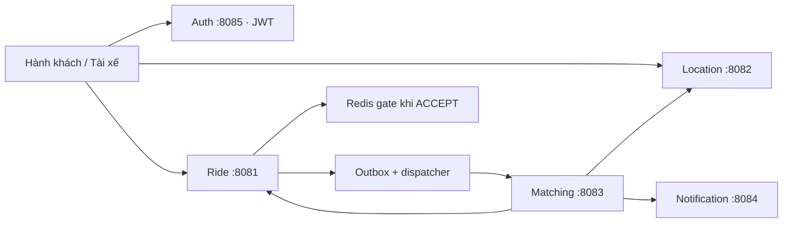

# Ride Share — Backend đặt xe (Pha 1)

Backend cho bài toán kết nối hành khách với tài xế gần điểm đón. Hệ thống gồm 5 service Go/Gin, giao tiếp REST/JSON qua HTTP. Trọng tâm là quản lý vòng đời cuốc xe và bảo đảm **một cuốc chỉ được một tài xế nhận thành công** khi nhiều người thao tác đồng thời.

## 1. Bài toán và nghiệp vụ

**Hành khách (RIDER)** đăng nhập, xem giá dự kiến, tạo/đọc cuốc và hủy khi chưa có tài xế. **Tài xế (DRIVER)** đăng nhập, cập nhật vị trí, bật nhận chuyến, nhận cuốc và cập nhật tiến trình.

Luồng chính:

1. Tài xế gửi tọa độ và bật `available=true`; chỉ tài xế available có tọa độ mới được xét.
2. Hành khách lấy báo giá rồi tạo cuốc với `fareId`, `pickupLocation:{lat,long}` và `radiusMeters` tùy chọn (mặc định 3000 m).
3. Ride lưu cuốc `REQUESTED` và công việc matching trong cùng transaction PostgreSQL. Sau commit, trả `201`; dispatcher chạy nền gửi công việc sang Matching.
4. Matching đọc trạng thái cuốc từ Ride, lấy tài xế gần từ Location theo khoảng cách Haversine, lưu snapshot ứng viên và yêu cầu Notification lưu thông báo cho từng người. Không có ứng viên thì job là `NO_DRIVERS`.
5. Tài xế chủ động gọi `ACCEPT`; Ride chọn người thắng bằng cập nhật SQL có điều kiện. Matching không tự gán tài xế. GET Matching đối chiếu Ride để trả `MATCHED` hoặc `CANCELLED`.

```text
REQUESTED → ACCEPTED → ARRIVED → IN_PROGRESS → COMPLETED
    └─────→ CANCELLED
```

Chỉ chủ cuốc được hủy từ `REQUESTED`; chỉ tài xế đã nhận được chuyển trạng thái theo thứ tự. GET cuốc dành cho chủ cuốc hoặc tài xế được gán. Danh tính người gọi lấy từ JWT. Retry ACCEPT của người thắng trả cùng kết quả khi cuốc còn `ACCEPTED`; tài xế khác nhận `409`. `DENY` chỉ đọc, chưa lưu lượt từ chối.

**Phạm vi hiện tại:** Ride, Location, Matching, Notification lưu PostgreSQL thật; Auth đăng nhập bằng fixture có hash bcrypt và phát JWT thật. Báo giá cố định, đăng ký tài khoản là mock (`persisted:false`). Notification `QUEUED` chỉ xác nhận đã lưu yêu cầu, chưa gửi push/email/SMS. RabbitMQ mới có topology, chưa nối publisher/consumer.

## 2. Kiến trúc, framework và tổ chức mã nguồn



Ride, Location, Matching, Notification dùng schema riêng trong cùng PostgreSQL; mỗi service chỉ truy cập schema của mình, không query hoặc tạo foreign key xuyên service. Các mũi tên giữa service là HTTP có `X-Internal-Token`. Auth đọc file fixture.

**Công nghệ:** Go 1.25.9, Gin 1.12 (HTTP/middleware/validation); PostgreSQL 16.10 + pgx/v5 (SQL/transaction); Redis 7.4.2 + go-redis/v9 (gate); JWT HS256 + bcrypt (xác thực); OpenAPI 3.0.3 + Swagger UI; Docker Compose và GitHub Actions. Dependency ở [go.mod](go.mod), image/digest ở [infra/versions.json](infra/versions.json).

```text
cmd/                         Entrypoint 5 service, migrate, seed, benchmark
internal/{auth,ride,location,matching,notification}/
  router.go, handler.go, dto.go  Lớp HTTP (Auth gộp handler trong router)
  service.go, application.go    Nghiệp vụ và các interface cần dùng
  postgres/                    Repository SQL của service có lưu DB
internal/ride/redisgate/       Adapter Redis
internal/ride/runtime/         Nối dependency và chạy dispatcher
internal/{contracts,clients}/ DTO dùng chung, client port và HTTP adapter
internal/platform/            Cấu hình, JWT, lỗi, health, Swagger
migrations/                   Migration version/checksum, chạy riêng
docs/openapi/                5 đặc tả YAML nhúng vào binary
scripts/, notebooks/          Smoke, integration runner, benchmark/Kaggle
```

Phân tầng: **API → nghiệp vụ → repository/client port → adapter**. Handler xử lý HTTP/validation; nghiệp vụ không import Gin, SQL driver, Redis hay RabbitMQ; adapter thực hiện I/O. Migration chạy trước ứng dụng, có transaction và advisory lock; ứng dụng không tự migrate.

## 3. Bài toán và cách kiểm thử hiệu năng

| Bài toán | Cách kiểm thử hiệu năng | Chỉ số đánh giá |
| --- | --- | --- |
| Nhiều tài xế cùng nhận một cuốc: chỉ một người được nhận thành công. | Tăng số request ACCEPT đồng thời vào cùng cuốc, lặp lại trên nhiều cuốc độc lập. | Latency p50/p95, request/giây, CPU/RAM; kiểm tra mỗi cuốc có đúng một người thắng, tách lỗi hệ thống khỏi xung đột nghiệp vụ dự kiến. |
| Vị trí và trạng thái tài xế thay đổi liên tục: kết quả tìm kiếm cần phản ánh dữ liệu đã cập nhật. | Tăng số tài xế và tần suất cập nhật vị trí/availability, đồng thời gửi truy vấn tìm gần; có trường hợp tài xế tắt nhận chuyến hoặc không còn ứng viên. | Throughput cập nhật/truy vấn, latency p95, CPU/RAM; đối chiếu kết quả với dữ liệu đã xác nhận cập nhật. |
| Tìm tài xế gần điểm đón trong một bán kính khi lượng tài xế lớn. | Sinh bộ tọa độ cố định cho 1.000–100.000 tài xế; thay đổi bán kính, mật độ và số truy vấn đồng thời. | Latency p50/p95, truy vấn/giây, CPU/RAM; đối chiếu danh sách và thứ tự khoảng cách với kết quả chuẩn. |
| Tính phí theo khoảng cách, thời gian, loại xe và quy tắc giá. | Chuẩn bị bộ đầu vào cố định, gồm các ngưỡng giá và trường hợp làm tròn; tăng số yêu cầu tính phí đồng thời. | Latency p50/p95, phép tính/giây, CPU/RAM; đối chiếu số tiền với kết quả kỳ vọng. |

Đây là kế hoạch kiểm thử trên Kaggle CPU. Giữ cùng cấu hình phần cứng, dữ liệu và workload khi so sánh; chạy warm-up và lặp lại phép đo. Tính phí hiện còn mock, cần triển khai quy tắc giá thật trước khi đo.

## 4. Đặc tả API và preview

| Service | File OpenAPI | Preview / Try it out |
| --- | --- | --- |
| Ride | [ride.yaml](docs/openapi/ride.yaml) | [localhost:8081](http://localhost:8081/swagger/index.html) |
| Location | [location.yaml](docs/openapi/location.yaml) | [localhost:8082](http://localhost:8082/swagger/index.html) |
| Matching | [matching.yaml](docs/openapi/matching.yaml) | [localhost:8083](http://localhost:8083/swagger/index.html) |
| Notification | [notification.yaml](docs/openapi/notification.yaml) | [localhost:8084](http://localhost:8084/swagger/index.html) |
| Auth | [auth.yaml](docs/openapi/auth.yaml) | [localhost:8085](http://localhost:8085/swagger/index.html) |
