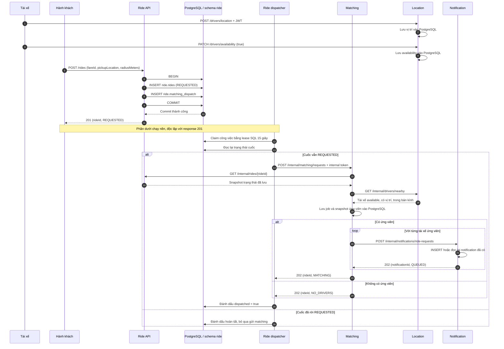
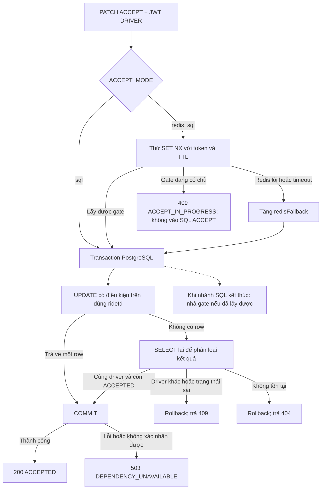
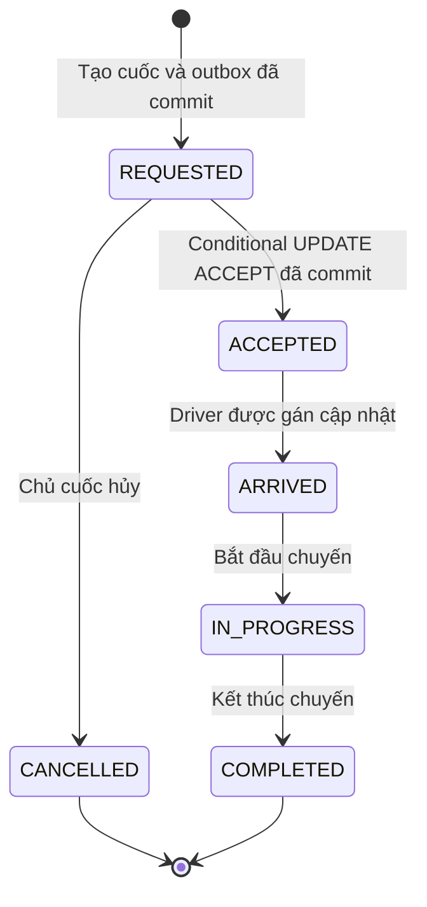

# Luồng đặt xe, matching và xử lý race condition

Tài liệu mô tả implementation hiện tại: tạo cuốc → tìm tài xế gần → lưu yêu cầu thông báo → tài xế nhận cuốc → hoàn tất chuyến. Phần nhận cuốc dùng Redis để giảm contention và transaction PostgreSQL với cập nhật có điều kiện để bảo đảm một cuốc chỉ có một tài xế thắng.

## 1. Thành phần và dữ liệu

| Thành phần | Trách nhiệm | Dữ liệu chính |
| --- | --- | --- |
| Auth | Xác thực tài khoản fixture, phát JWT | File tài khoản có hash bcrypt |
| Ride | Quản lý cuốc, chọn tài xế thắng khi ACCEPT, gửi yêu cầu matching | `ride.rides`, `ride.matching_dispatch` |
| Location | Lưu vị trí/availability, tìm tài xế trong bán kính bằng Haversine | `location.drivers` |
| Matching | Lưu job và snapshot ứng viên, yêu cầu thông báo | `matching.requests` |
| Notification | Lưu yêu cầu `RIDE_REQUEST`, chống lưu trùng | `notification.requests` |
| Redis | Gate ngắn hạn theo từng cuốc khi ACCEPT | `ride:accept:{rideId}` |

API public dùng JWT; `riderId` và `driverId` của người thực hiện lấy từ token. Các service gọi nhau qua HTTP với `X-Internal-Token`. Mỗi service thao tác schema của mình; Matching không query trực tiếp bảng Ride/Location/Notification.

## 2. Luồng chính: tạo cuốc → matching → thông báo

### 2.1. Chuẩn bị và tạo cuốc

1. Tài xế đăng nhập, gửi vị trí bằng `POST /drivers/location`, rồi bật nhận chuyến bằng `PATCH /drivers/availability` với `available:true`.
2. Hành khách đăng nhập; có thể gọi `POST /fare` để lấy báo giá. Giá hiện vẫn là mock cố định.
3. Hành khách gọi `POST /rides` với điểm đón rõ ràng. `radiusMeters` có thể bỏ qua, mặc định 3000 mét.

```json
{
  "fareId": "fare_123",
  "pickupLocation": { "lat": 21.0285, "long": 105.8542 },
  "radiusMeters": 3000
}
```

4. Trong **một transaction PostgreSQL**, Ride ghi cuốc `REQUESTED`, `driver_id = NULL` và một công việc matching vào `ride.matching_dispatch`.
5. Commit thành công mới trả `201 {rideId,status:"REQUESTED"}`. Nếu một trong hai bản ghi lỗi, transaction rollback cả hai.

`201` xác nhận cuốc và công việc matching đã lưu bền. Matching và Notification được xử lý nền sau đó; chưa thể suy ra đã có tài xế hoặc đã lưu đủ thông báo từ response này.

### 2.2. Dispatcher và matching



Sơ đồ minh họa nhánh thành công. Nếu cuốc đổi trạng thái sau lần dispatcher đọc nhưng trước khi Matching đọc, Matching kiểm tra lại và có thể từ chối job mới hoặc trả trạng thái cuối của job đã có.

Location chỉ xét tài xế `available=true` và đã có tọa độ. Kết quả sắp theo khoảng cách rồi `driverId`; Matching lưu snapshot ứng viên để các lần retry dùng cùng danh sách. Matching không gán tài xế thắng và không gọi ACCEPT.

### 2.3. Retry, restart và chống trùng

| Cơ chế | Hành vi |
| --- | --- |
| Outbox cùng transaction với cuốc | Tránh tạo cuốc thành công nhưng mất công việc matching |
| Dispatcher poll mỗi giây | Lấy tối đa 20 công việc mỗi vòng; thời gian thực tế còn phụ thuộc xử lý HTTP |
| Lease SQL 15 giây, `FOR UPDATE SKIP LOCKED` | Giảm việc nhiều Ride replica claim cùng một row; không giữ transaction trong lúc gọi HTTP |
| Retry sau lỗi/mất response | Giữ công việc chưa hoàn tất; có thể xử lý lại khi lease hết |
| Restart Ride | Công việc vẫn nằm trong DB; replica khác hoặc tiến trình mới có thể tiếp tục |
| Matching idempotency | Cùng `rideId`, pickup và radius dùng cùng job; input khác trả `409 MATCHING_REQUEST_CONFLICT` |
| Notification idempotency | Unique constraint `(ride_id, driver_id, type)` giữ một yêu cầu cho mỗi tài xế/cuốc/type |

Nếu Notification đã commit nhưng response bị mất, Matching có thể gửi lại. Notification trả bản ghi cũ và giữ nguyên `notificationId`. Đây là gửi **at-least-once kết hợp dedup tại đích**, không phải transaction phân tán giữa các service.

Job có thể đã tồn tại trong khi POST Matching trả `503` do chưa lưu đủ notification. GET thấy job `MATCHING` không chứng minh mọi notification đã xong; dispatcher chỉ hoàn tất sau response POST hợp lệ. `QUEUED` nghĩa yêu cầu đã lưu, chưa có push tới thiết bị, email/SMS hoặc RabbitMQ delivery.

## 3. Race condition khi nhiều tài xế cùng nhận một cuốc

Giả sử tài xế A và B cùng gửi:

```http
PATCH /rides/{rideId}
Authorization: Bearer <JWT của tài xế>
Content-Type: application/json

{"action":"ACCEPT"}
```

Cả hai request có thể đến các Ride replica khác nhau. Nếu mỗi request chỉ đọc `REQUESTED` rồi ghi `driver_id` bằng một UPDATE không có điều kiện, request sau có thể ghi đè người trước. Việc đọc thấy cuốc trống không giữ chỗ cho tài xế.

Implementation dùng hai lớp với vai trò riêng:

| Lớp | Mục tiêu | Khi lớp này lỗi hoặc không được dùng |
| --- | --- | --- |
| Redis gate | Giảm số request đồng thời đi xuống transaction ACCEPT của DB | Có thể tăng cạnh tranh ở DB; PostgreSQL vẫn quyết định kết quả |
| Conditional UPDATE + transaction PostgreSQL | Chỉ cho phép chuyển `REQUESTED, driver_id=NULL` thành `ACCEPTED, driver_id=<winner>` một lần | Nếu không xác nhận được commit, không trả thành công |

### 3.1. Redis giảm contention

Ở chế độ `ACCEPT_MODE=redis_sql` mặc định, Ride thử lấy gate bằng thao tác tương đương:

```text
SET ride:accept:{rideId} <random-token> NX PX 5000
```

`NX` chỉ đặt key khi chưa tồn tại; `PX 5000` đặt hạn 5000 ms. Hai tùy chọn nằm trong cùng lệnh SET. Xem [Redis SET](https://redis.io/docs/latest/commands/set/).

- Lấy được gate: tiếp tục xuống SQL.
- Key đang tồn tại: trả ngay `409 ACCEPT_IN_PROGRESS`, không gọi repository ACCEPT.
- Redis lỗi hoặc timeout: tăng `redisFallback` và tiếp tục xuống SQL.
- `ACCEPT_MODE=sql`: bỏ qua Redis gate, chạy cùng logic SQL nhận cuốc.

Gate theo **rideId**, không khóa toàn bộ hệ thống. Trong một đợt nhiều request cùng cuốc, gate có thể loại bớt request trước DB. Không thể coi đây là bảo đảm chỉ có đúng một lượt SQL cho cả cuốc: gate có thể được nhả, hết TTL hoặc gặp lỗi, và request mới vẫn có thể đến sau đó.



Lỗi DB ở bước BEGIN/UPDATE/SELECT cũng trả `503`. `driverId` dùng trong SQL lấy từ JWT, không nhận danh tính tự khai trong body.

### 3.2. Nhả gate đúng chủ sở hữu

Mỗi lần lấy gate dùng token ngẫu nhiên. Cleanup chạy Lua để kiểm tra token và xóa key trong cùng lần thực thi:

```lua
if redis.call('GET', KEYS[1]) == ARGV[1] then
    return redis.call('DEL', KEYS[1])
else
    return 0
end
```

Ví dụ request A xử lý chậm, gate A hết TTL, rồi B đặt gate mới. Khi A kết thúc, token A không khớp token B nên A không xóa gate của B. Nếu tiến trình chết hoặc cleanup thất bại, TTL cho phép gate tự hết hạn. TTL mặc định 5 giây không được gia hạn; không có giả định gate luôn còn hiệu lực đến khi SQL xong.

### 3.3. Transaction và atomic conditional UPDATE giải race

Repository ACCEPT mở transaction với isolation level `READ COMMITTED`. Câu lệnh quyết định người thắng là:

```sql
UPDATE ride.rides
SET driver_id = $2,
    status = 'ACCEPTED',
    updated_at = now()
WHERE id = $1
  AND status = 'REQUESTED'
  AND driver_id IS NULL
RETURNING id, fare_id, rider_id, driver_id, status;
```

Điều kiện kiểm tra và thao tác gán tài xế nằm trong **cùng một UPDATE atomic**. Không có khoảng hở giữa việc đọc thấy cuốc trống và cập nhật cuốc. Transaction giữ thay đổi chưa commit; application chỉ trả `200` sau khi `Commit()` thành công. Chỉ thêm `BEGIN/COMMIT` quanh cách đọc trước rồi UPDATE vô điều kiện sẽ không tạo ra bảo đảm này.

Với `READ COMMITTED`, hai UPDATE cùng row có thể khiến một transaction phải chờ. Nếu transaction trước commit, PostgreSQL đánh giá lại `WHERE` trên phiên bản row đã cập nhật; nếu trước rollback, transaction còn lại có thể tiếp tục cập nhật. Xem [PostgreSQL 16: Read Committed](https://www.postgresql.org/docs/16/transaction-iso.html#XACT-READ-COMMITTED).

Giả sử A cập nhật được trước và **commit thành công**:

```mermaid
sequenceDiagram
    autonumber
    participant A as Request A / Ride replica 1
    participant B as Request B / Ride replica 2
    participant DB as PostgreSQL

    Note over A,B: Cùng vào SQL vì mode sql, Redis lỗi hoặc gate hết TTL
    Note over DB: Ban đầu REQUESTED, driver_id = NULL
    A->>DB: BEGIN READ COMMITTED
    A->>DB: UPDATE có điều kiện, driver_id = A
    DB-->>A: RETURNING một row; thay đổi chưa commit
    B->>DB: BEGIN READ COMMITTED
    B->>DB: UPDATE có điều kiện, driver_id = B
    Note over B,DB: Nếu row đang bị A khóa, B chờ
    A->>DB: COMMIT
    DB-->>A: Commit thành công
    A-->>A: Trả 200 ACCEPTED
    Note over DB: Row hiện là ACCEPTED, driver_id = A
    DB->>DB: Đánh giá lại WHERE cho UPDATE của B
    DB-->>B: Không có row thỏa điều kiện
    B->>DB: SELECT lại cuốc trong transaction
    DB-->>B: ACCEPTED, driver_id = A
    B->>DB: ROLLBACK
    B-->>B: Trả 409 RIDE_ALREADY_ACCEPTED
```

Nếu B chỉ bắt đầu UPDATE sau khi A commit thì điều kiện cũng không khớp, không cần chờ A. Nếu A rollback, A không được công nhận là người thắng; B có thể cập nhật và commit. Thứ tự request đến API không bảo đảm thứ tự thắng.

Schema còn kiểm tra quan hệ giữa trạng thái và tài xế: `REQUESTED`/`CANCELLED` phải có `driver_id=NULL`; các trạng thái từ `ACCEPTED` trở đi phải có tài xế. Constraint bảo vệ hình dạng dữ liệu; conditional UPDATE bảo vệ chuyển trạng thái khi cạnh tranh.

### 3.4. Redis lỗi hoặc gate hết TTL vẫn giữ được tính đúng

Nếu A đang giữ gate nhưng chưa hoàn tất SQL, TTL có thể hết và B lấy được gate mới. Khi đó cả A và B có thể cùng chạy SQL. PostgreSQL xử lý cạnh tranh bằng cùng điều kiện UPDATE ở trên; tài xế đã commit không bị request sau ghi đè.

Điều này cũng đúng khi Redis mất kết nối: các request fallback xuống SQL có thể làm DB bận hơn, nhưng vẫn giữ quy tắc một cuốc/một tài xế thắng. Redis và PostgreSQL không nằm trong một transaction chung; lấy được Redis gate chưa phải nhận cuốc thành công.

### 3.5. Kết quả, retry và lỗi commit

| Tình huống khi xuống SQL | Kết quả |
| --- | --- |
| Cuốc còn REQUESTED, chưa gán driver; UPDATE và commit thành công | `200 ACCEPTED` |
| Retry cùng driver, cuốc vẫn ACCEPTED | Commit nhánh đọc lại, trả `200` cùng kết quả |
| Driver khác đã nhận cuốc | `409 RIDE_ALREADY_ACCEPTED` |
| Cuốc CANCELLED, hoặc cùng driver retry khi đã ARRIVED/IN_PROGRESS/COMPLETED | `409 INVALID_RIDE_STATE` |
| Cuốc không tồn tại | `404 RIDE_NOT_FOUND` |
| DB lỗi/timeout hoặc không xác nhận được commit | `503 DEPENDENCY_UNAVAILABLE` |

Redis gate được kiểm tra trước DB: ngay cả retry của cùng driver cũng có thể nhận `409 ACCEPT_IN_PROGRESS` nếu gate đang bị giữ. Code này chỉ nói có request đang giữ gate, chưa kết luận tài xế nào thắng.

Nếu mất kết nối lúc commit, `503` không chứng minh transaction đã rollback. Client có thể đọc lại hoặc retry cùng danh tính; retry ACCEPT chỉ trả lại thành công khi cuốc vẫn `ACCEPTED` và thuộc cùng driver. Không tự giả định mình đã thắng từ việc từng lấy được gate.

### 3.6. ACCEPT cạnh tranh với hủy cuốc

DELETE của chủ cuốc chỉ chuyển `REQUESTED → CANCELLED`. ACCEPT cũng chỉ chuyển từ `REQUESTED` và chưa có tài xế. Hai cập nhật cạnh tranh trên cùng row:

- ACCEPT commit trước: cuốc thành `ACCEPTED`; hủy không còn khớp điều kiện và trả `409 INVALID_RIDE_STATE`.
- Hủy commit trước: cuốc thành `CANCELLED`; ACCEPT không còn khớp điều kiện và trả `409 INVALID_RIDE_STATE`.

Nhánh hủy không lấy Redis gate. Tính đúng của race ACCEPT/DELETE vẫn dựa vào điều kiện SQL; không cần mọi thao tác cùng tuân theo khóa Redis.

## 4. Vòng đời sau khi nhận cuốc



Driver đã nhận cuốc dùng `PATCH /rides/{rideId}/status` để chuyển tuần tự. GET Ride đọc dữ liệu đã lưu. GET Matching đối chiếu Ride để chuyển job sang `MATCHED` khi Ride đã được nhận, hoặc `CANCELLED` khi Ride bị hủy; chưa có event tự đồng bộ ngay tại thời điểm ACCEPT.

`DENY` hiện chỉ đọc và trả snapshot, không lưu lượt từ chối. Matching `NO_DRIVERS` là trạng thái của job, không tự đổi Ride từ `REQUESTED`; snapshot ứng viên cũng không tự tìm lại khi có driver online sau đó.

## 5. Phân biệt các bảo đảm và giới hạn

| Cơ chế | Bảo đảm trong phạm vi hiện tại |
| --- | --- |
| Transaction tạo cuốc | Ghi cuốc và outbox cùng commit hoặc cùng rollback |
| Lease dispatcher | Giảm xử lý trùng công việc giữa replica; vẫn phải chấp nhận gửi lại |
| Unique constraint Notification | Chống trùng dữ liệu khi request notification bị gửi lại |
| Redis gate ACCEPT | Giảm contention trước DB, không quyết định tài xế thắng |
| Conditional UPDATE + commit ACCEPT | Bảo vệ một cuốc chỉ có một tài xế thắng, kể cả khi bỏ Redis |

Hệ thống chưa bảo vệ quy tắc một tài xế chỉ có một cuốc đang chạy, chưa kiểm tra driver ACCEPT thuộc snapshot matching hay còn available. Chưa có idempotency key cho `POST /rides`: gửi lại request tạo cuốc có thể tạo cuốc mới. Notification `QUEUED` chưa đồng nghĩa thiết bị nhận được; thông báo đã lưu không bị thu hồi khi nhận/hủy cuốc và lời gọi đang xử lý có thể chạy đồng thời với đổi trạng thái. Auth register và fare estimation vẫn mock.

## 6. Mã nguồn và kiểm chứng

Các điểm triển khai để đối chiếu:

- [Tạo cuốc và outbox](../internal/ride/create_matching.go), [transaction ghi và lease dispatch](../internal/ride/postgres/dispatch.go), [dispatcher](../internal/ride/runtime/dispatch.go).
- [Matching application](../internal/matching/application.go), [Location application](../internal/location/application.go), [Notification repository và dedup](../internal/notification/postgres/repository.go).
- [Điều phối gate và ACCEPT](../internal/ride/service.go), [Redis token/TTL/Lua](../internal/ride/redisgate/gate.go), [conditional UPDATE và commit](../internal/ride/postgres/repository.go).
- [Schema Ride](../migrations/001_rides.sql), [schema service và outbox](../migrations/002_matching_flow.sql), [API catalog](api-catalog.md), [chi tiết endpoint Ride](ride-service-business.md).

Các integration test tương ứng nằm trong [flow_test.go](../internal/integration/flow_test.go) và [ride_test.go](../internal/integration/ride_test.go):

| Test | Nội dung kiểm chứng |
| --- | --- |
| `TestPersistedMatchingFlowAndRestartRecovery` | HTTP thật, mất acknowledgement, restart, retry/dedup, NO_DRIVERS và cập nhật Matching |
| `TestMatchingDispatchAtomicityAndLease` | Rollback khi outbox lỗi; cạnh tranh lease giữa replica |
| `TestConcurrentAcceptanceAcrossReplicas` | Một tài xế thắng khi nhiều request ACCEPT vào hai Ride replica, ở cả `sql` và `redis_sql` |
| `TestGateRejectionSkipsSQL` | Gate đang giữ thì không gọi transaction ACCEPT |
| `TestRedisFailureFallsBackAndDBFailureIs503` | Redis lỗi vẫn xuống SQL; DB lỗi không trả thành công giả |
| `TestExpiredLockCannotDeleteNewOwner` | Token cũ không xóa gate của chủ mới sau khi TTL hết |
| `TestCrashedOwnerRecoversAfterTTL` | Gate tự giải phóng sau khi tiến trình giữ gate chết |
| `TestCancellationRacesAcceptance` | ACCEPT cạnh tranh với DELETE vẫn chỉ có một chuyển trạng thái thắng |

Để chạy kiểm chứng bằng PostgreSQL/Redis tạm, tự dừng tiến trình khi xong:

```bash
GOTOOLCHAIN=go1.25.9 python3 scripts/native_check.py
```

Các counter tại `GET /internal/metrics` của từng Ride replica giúp quan sát: `redisRejected` là số request bị gate chặn; `redisFallback` là số lần lỗi gate và tiếp tục SQL; `sqlAttempts` là số lần gọi repository ACCEPT, không phải tổng SQL statement hoặc số cuốc thành công. Khi so sánh hai mode cần đo cùng workload và cộng delta counter của các replica; không suy ra mức cải thiện hiệu năng chỉ từ sơ đồ.
