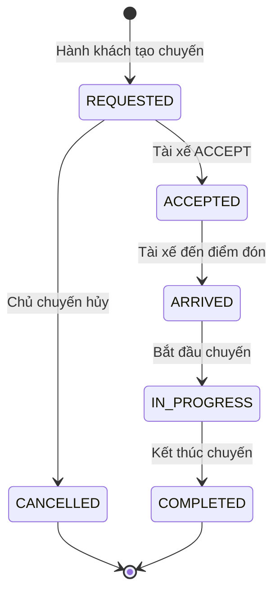

# Nghiệp vụ các endpoint của Ride Service

Tài liệu mô tả hành vi theo mã nguồn trong workspace ngày 28/10/2026, bao gồm luồng matching bất đồng bộ đang được bổ sung. Đây là mô tả triển khai hiện tại, không phải các chức năng dự kiến. Một số mô tả trong README cũ chưa phản ánh luồng này.

Ride Service quản lý vòng đời chuyến đi: báo giá, tạo yêu cầu đặt xe, ghi nhận tài xế nhận chuyến, cập nhật tiến độ, hủy và tra cứu. Địa chỉ local mặc định: `http://localhost:8081`.

## 1. Khái niệm và quy tắc chung

### 1.1. Tác nhân và quyền truy cập

| Tác nhân | Vai trò nghiệp vụ | Xác thực |
| --- | --- | --- |
| Hành khách | Báo giá, đặt xe, xem và hủy chuyến của mình | JWT với role `RIDER` |
| Tài xế | Nhận/từ chối chuyến, cập nhật tiến độ, xem chuyến được giao | JWT với role `DRIVER` |
| Service nội bộ | Đọc thông tin chuyến, đọc số liệu vận hành | Header `X-Internal-Token` |

API public dùng `Authorization: Bearer <accessToken>`. `riderId` và `driverId` dùng để thực hiện nghiệp vụ được lấy từ JWT; không lấy danh tính người thực hiện từ body. Sai hoặc thiếu JWT trả `401 UNAUTHORIZED`; đúng JWT nhưng sai role trả `403 FORBIDDEN`.

API nội bộ kiểm tra token dùng chung, không kiểm tra quyền sở hữu theo người dùng. JWT public không thay thế được internal token.

### 1.2. Dữ liệu chuyến đi

| Trường | Ý nghĩa |
| --- | --- |
| `rideId` | Mã chuyến, tự sinh dạng `ride_` kèm 32 ký tự hex |
| `fareId` | Mã báo giá do client cung cấp khi tạo chuyến |
| `riderId` | Hành khách tạo chuyến |
| `driverId` | Tài xế đã nhận chuyến; luôn xuất hiện trong response chi tiết, bằng `null` khi chưa có tài xế |
| `status` | Trạng thái hiện tại được lưu trong PostgreSQL |

`ride.rides` còn có `created_at`, `updated_at`, nhưng API chi tiết chưa trả hai trường này. Điểm đón và bán kính tìm xe được lưu trong `ride.matching_dispatch`, không nằm trong response chi tiết chuyến. Ride chưa lưu điểm đến hoặc số tiền báo giá vào bản ghi chuyến.

### 1.3. Vòng đời chuyến



| Trạng thái | Ý nghĩa | Tài xế |
| --- | --- | --- |
| `REQUESTED` | Đã tạo yêu cầu; đang chờ tài xế nhận | `null` |
| `ACCEPTED` | Một tài xế đã nhận chuyến | Đã xác định |
| `ARRIVED` | Tài xế báo đã đến điểm đón | Đã xác định |
| `IN_PROGRESS` | Chuyến đang diễn ra | Đã xác định |
| `COMPLETED` | Chuyến đã hoàn tất | Đã xác định |
| `CANCELLED` | Hành khách đã hủy trước khi tài xế nhận | `null` |

Không được bỏ qua bước hoặc quay lại trạng thái trước. `DENY` không làm đổi trạng thái. Trạng thái matching như `MATCHING`, `NO_DRIVERS` thuộc Matching Service, không phải trạng thái của Ride.

### 1.4. Kiểm tra đầu vào và lỗi chung

- Body phải là đúng một tài liệu JSON, tối đa 1 MiB. Sai kiểu, thiếu trường bắt buộc hoặc sai giá trị trả `400 VALIDATION_ERROR`.
- Tọa độ dùng tên trường `lat`, `long`; cả hai bắt buộc. `lat` trong `[-90, 90]`, `long` trong `[-180, 180]`. Giá trị `0` hợp lệ.
- `rideId` trên URL phải có ký tự khác khoảng trắng. Hiện không bắt buộc ID phải khớp định dạng ID tự sinh; mã không tồn tại sẽ được xử lý khi tra cứu DB.
- Tên action và status phân biệt hoa/thường.
- Lỗi PostgreSQL khi xử lý nghiệp vụ được ánh xạ thành `503 DEPENDENCY_UNAVAILABLE`; timeout DB mặc định là 2 giây, có thể cấu hình bằng `DB_TIMEOUT`.

Định dạng lỗi chung:

```json
{
  "error": {
    "code": "INVALID_RIDE_STATE",
    "message": "Invalid ride state",
    "details": []
  }
}
```

Response có header `X-Request-ID` để đối chiếu log. Lỗi ngoài các trường hợp được ánh xạ trả `500 INTERNAL_ERROR`.

## 2. Danh sách endpoint nghiệp vụ

| Method | Endpoint | Quyền | Mục đích |
| --- | --- | --- | --- |
| POST | `/fare` | RIDER | Lấy báo giá ước tính |
| POST | `/rides` | RIDER | Tạo chuyến và yêu cầu gửi sang Matching |
| GET | `/rides/{rideId}` | Chủ chuyến hoặc tài xế được giao | Xem thông tin chuyến |
| PATCH | `/rides/{rideId}` | DRIVER | Nhận hoặc từ chối chuyến |
| PATCH | `/rides/{rideId}/status` | Tài xế được giao | Cập nhật tiến độ chuyến |
| DELETE | `/rides/{rideId}` | RIDER là chủ chuyến | Hủy chuyến chưa được nhận |
| GET | `/internal/rides/{rideId}` | Internal token | Đọc chuyến phục vụ liên service |

## 3. POST `/fare` — Ước tính giá chuyến đi

**Mục đích:** cho hành khách xem giá và thời gian ước tính trước khi đặt xe.

Request:

```json
{
  "pickupLocation": { "lat": 21.0285, "long": 105.8542 },
  "destination": { "lat": 21.0350, "long": 105.8200 }
}
```

Luồng xử lý:

1. Xác thực JWT và role `RIDER`.
2. Kiểm tra đủ điểm đón, điểm đến và tọa độ hợp lệ.
3. Trả báo giá cố định từ service mock, không tính theo khoảng cách hoặc thời điểm.

Response `200 OK` hiện luôn là:

```json
{ "fareId": "fare_123", "estimatedFare": 85000, "etaMinutes": 12 }
```

Endpoint không ghi DB, không lưu báo giá, không kiểm tra tuyến đường và không gọi dịch vụ bản đồ. Chưa có hạn dùng hoặc cơ chế ràng buộc `fareId` với hành khách/tọa độ. Lỗi trực tiếp: `400` do body; `401` do JWT; `403` do sai role.

## 4. POST `/rides` — Tạo chuyến và khởi động matching

**Mục đích:** ghi nhận yêu cầu đặt xe của hành khách và bảo đảm yêu cầu tìm tài xế được lưu bền vững để gửi tiếp.

Request:

```json
{
  "fareId": "fare_123",
  "pickupLocation": { "lat": 21.0285, "long": 105.8542 },
  "radiusMeters": 3000
}
```

| Trường | Quy tắc |
| --- | --- |
| `fareId` | Bắt buộc, không rỗng hoặc chỉ có khoảng trắng |
| `pickupLocation` | Bắt buộc, đủ tọa độ hợp lệ |
| `radiusMeters` | Có thể bỏ qua, mặc định 3000 mét; nếu truyền phải là số hữu hạn lớn hơn 0; `null` bị từ chối |

Luồng xử lý đồng bộ:

1. Xác thực `RIDER`, lấy `riderId` từ JWT và kiểm tra body.
2. Sinh `rideId` mới; đặt trạng thái ban đầu `REQUESTED`, chưa có tài xế.
3. Mở transaction PostgreSQL và ghi chuyến vào `ride.rides`.
4. Trong cùng transaction, ghi điểm đón và bán kính vào `ride.matching_dispatch` với `dispatched=false`.
5. Commit cả hai bản ghi rồi trả `201 Created`. Nếu ghi một trong hai thất bại, transaction rollback.

Response ví dụ:

```json
{ "rideId": "ride_0123456789abcdef0123456789abcdef", "status": "REQUESTED" }
```

`201` xác nhận đã lưu chuyến và công việc gửi matching; không xác nhận đã tìm thấy tài xế hoặc đã gửi thông báo thành công.

Luồng gửi nền sau khi tạo:

1. Dispatcher của Ride lấy công việc chưa gửi đến hạn từ DB. Cơ chế lease 15 giây và `SKIP LOCKED` hỗ trợ nhiều replica cùng xử lý.
2. Đọc lại chuyến. Nếu vẫn `REQUESTED`, gọi `POST /internal/matching/requests` tại Matching Service, gửi `rideId`, `pickupLocation`, `radiusMeters` và internal token.
3. Khi lời gọi thành công và response hợp lệ, đánh dấu công việc `dispatched=true`. Nếu chuyến đã rời `REQUESTED` tại thời điểm đọc, bỏ qua lời gọi và cũng đánh dấu xong.
4. Khi lỗi, giữ công việc để thử lại sau khi lease hết hạn. Dispatcher kiểm tra theo nhịp 1 giây, mỗi vòng lấy tối đa 20 công việc. Khi tiến trình khởi động lại, công việc chưa hoàn tất vẫn còn trong DB.

Có thể gửi lại cùng yêu cầu xuống Matching nếu lần gọi trước đã được xử lý nhưng Ride chưa ghi nhận thành công; đây là cơ chế gửi có thể lặp. Việc đọc trạng thái trước khi gửi không khóa chuyến trong suốt lời gọi HTTP, nên nhận/hủy có thể xảy ra đồng thời.

Các quy tắc hiện tại:

- Chỉ kiểm tra `fareId` không rỗng; chưa kiểm tra báo giá tồn tại, hết hạn hoặc thuộc đúng hành khách.
- Chưa giới hạn một hành khách chỉ có một chuyến đang hoạt động.
- Gửi lại `POST /rides` tạo chuyến mới; endpoint chưa hỗ trợ khóa chống tạo trùng. Nếu client mất response sau commit, gửi lại có thể tạo thêm chuyến.
- Matching lỗi sau commit không làm mất hoặc rollback chuyến đã tạo. Ride không trực tiếp gửi thông báo cho tài xế ở endpoint này.

Lỗi: `400` đầu vào không hợp lệ; `401/403` xác thực/quyền; `503 DEPENDENCY_UNAVAILABLE` nếu không thể ghi transaction hoặc tạo công việc matching.

## 5. GET `/rides/{rideId}` — Xem chi tiết chuyến

**Mục đích:** cho người tham gia chuyến xem trạng thái đã lưu.

Không có body. Luồng xử lý:

1. Xác thực JWT, kiểm tra `rideId` và đọc chuyến từ PostgreSQL.
2. Nếu không có chuyến, trả `404 RIDE_NOT_FOUND`.
3. Chỉ cho phép `RIDER` có `userId = riderId` của chuyến, hoặc `DRIVER` có `userId = driverId` đã được giao. Các trường hợp khác trả `403 FORBIDDEN`.
4. Trả `200 OK` với dữ liệu hiện tại, không thay đổi DB.

```json
{
  "rideId": "ride_0123456789abcdef0123456789abcdef",
  "fareId": "fare_123",
  "riderId": "rider_123",
  "driverId": null,
  "status": "REQUESTED"
}
```

Tài xế chưa nhận chuyến không thể dùng endpoint này để xem cuốc đang chờ, kể cả khi biết `rideId`. Endpoint không tổng hợp trạng thái matching, tọa độ hoặc thông báo từ service khác. Lỗi khác: `400` ID không hợp lệ, `401` JWT, `503` DB.

## 6. PATCH `/rides/{rideId}` — Nhận hoặc từ chối chuyến

**Mục đích:** cho tài xế phản hồi một yêu cầu chuyến đi. Yêu cầu role `DRIVER`.

Request nhận chuyến:

```json
{ "action": "ACCEPT" }
```

Request từ chối:

```json
{ "action": "DENY" }
```

### 6.1. Nhánh `ACCEPT`

1. Xác thực tài xế, kiểm tra ID và action.
2. Ở chế độ mặc định `redis_sql`, thử lấy gate Redis theo `ride:accept:{rideId}` với TTL mặc định 5 giây. Gate đang bị giữ thì trả `409 ACCEPT_IN_PROGRESS`, không gọi repository nhận chuyến. Redis lỗi thì tiếp tục xuống SQL. Chế độ `sql` bỏ bước gate.
3. Trong transaction `READ COMMITTED`, chỉ cập nhật chuyến khi trạng thái là `REQUESTED` và `driver_id IS NULL`: gán tài xế từ JWT, đổi thành `ACCEPTED`, cập nhật `updated_at`.
4. Nếu cập nhật không được bản ghi nào, đọc lại chuyến để phân loại: không tồn tại; đã có tài xế khác; cùng tài xế đang giữ chuyến ở `ACCEPTED`; hoặc trạng thái không hợp lệ.
5. Chỉ trả thành công sau commit; nhả gate bằng cách đối chiếu token sở hữu để tránh xóa gate của request mới.

Response `200 OK`:

```json
{
  "rideId": "ride_0123456789abcdef0123456789abcdef",
  "action": "ACCEPT",
  "driverId": "driver_456",
  "status": "ACCEPTED"
}
```

| Tình huống | Kết quả |
| --- | --- |
| Chuyến `REQUESTED`, chưa có tài xế | Nhận thành công |
| Cùng tài xế gửi lại khi chuyến vẫn `ACCEPTED` | `200`, trả lại kết quả hiện có nếu qua được gate |
| Chuyến đã có tài xế khác | `409 RIDE_ALREADY_ACCEPTED` |
| Chuyến đã `CANCELLED`, hoặc cùng tài xế gửi lại sau khi chuyến đã tiến đến `ARRIVED` trở đi | `409 INVALID_RIDE_STATE` |
| Gate đang bị giữ, kể cả request lặp của cùng tài xế | `409 ACCEPT_IN_PROGRESS` trước khi kiểm tra DB |
| Không tìm thấy chuyến sau khi xuống DB | `404 RIDE_NOT_FOUND` |

PostgreSQL quyết định tài xế thắng cuối cùng; Redis chỉ giảm số request cạnh tranh. Khi nhiều tài xế nhận cùng lúc, điều kiện cập nhật SQL bảo đảm một chuyến chỉ gán cho một tài xế, kể cả khi Redis lỗi hoặc gate hết TTL.

Hiện endpoint chưa kiểm tra tài xế có nằm trong danh sách matching, có ở gần điểm đón, đang bật nhận chuyến hoặc đang phục vụ chuyến khác. Một tài xế có thể nhận nhiều chuyến khác nhau. Endpoint chưa trực tiếp cập nhật availability của Location hoặc phát event RabbitMQ.

### 6.2. Nhánh `DENY`

1. Xác thực role `DRIVER`, kiểm tra body rồi đọc chuyến.
2. Trả `200` gồm `rideId`, `action: DENY`, `driverId` và `status` hiện tại của chuyến.
3. Không ghi lượt từ chối, không đổi trạng thái, không xóa tài xế, không gọi Redis hoặc chuyển sang ứng viên khác.

Nhánh này chưa kiểm tra tài xế là ứng viên hay chủ chuyến và chưa giới hạn trạng thái. Bất kỳ tài xế có JWT hợp lệ nào biết mã chuyến tồn tại đều có thể gọi `DENY`, kể cả khi chuyến đã hoàn tất/hủy. `driverId` trong kết quả là tài xế đang được giao cho chuyến, có thể là `null` hoặc là người khác; không phải danh tính người vừa từ chối.

Lỗi chung của endpoint: `400` action/ID sai; `401/403` JWT/role; `404` không có chuyến; `503` DB. Các lỗi `409` nêu trên thuộc nhánh `ACCEPT`.

## 7. PATCH `/rides/{rideId}/status` — Cập nhật tiến độ

**Mục đích:** tài xế được giao xác nhận các mốc của chuyến đi.

Request ví dụ:

```json
{ "status": "ARRIVED" }
```

| Giá trị yêu cầu | Trạng thái trước bắt buộc | Ý nghĩa |
| --- | --- | --- |
| `ARRIVED` | `ACCEPTED` | Đã đến điểm đón |
| `IN_PROGRESS` | `ARRIVED` | Đã bắt đầu chở khách |
| `COMPLETED` | `IN_PROGRESS` | Đã kết thúc chuyến |

Luồng xử lý:

1. Xác thực role `DRIVER`; chỉ chấp nhận ba giá trị trên.
2. Cập nhật SQL có điều kiện theo `rideId`, `driverId` từ JWT và trạng thái trước tương ứng; cập nhật `updated_at` nếu thành công.
3. Nếu không cập nhật được, đọc lại: không có chuyến trả `404`; chưa có tài xế hoặc tài xế khác trả `403`; đúng tài xế và trạng thái hiện tại đã bằng trạng thái yêu cầu thì trả `200`; còn lại trả `409 INVALID_RIDE_STATE`.

Response `200 OK`:

```json
{ "rideId": "ride_0123456789abcdef0123456789abcdef", "status": "ARRIVED" }
```

Gửi lại cùng trạng thái là an toàn khi chuyến vẫn đang ở trạng thái đó. Nếu chuyến đã tiến xa hơn, gửi lại mốc cũ bị từ chối. Không thể dùng endpoint này để nhận chuyến hoặc hủy; truyền `ACCEPTED`, `REQUESTED`, `CANCELLED` trả `400 VALIDATION_ERROR` ngay ở body.

Hiện các mốc do tài xế khai báo; chưa xác minh vị trí đến đón, xác nhận của hành khách, thanh toán hoặc giải phóng availability khi hoàn tất. Lỗi khác: `400`, `401`, `403` sai role và `503` DB.

## 8. DELETE `/rides/{rideId}` — Hủy chuyến

**Mục đích:** chủ chuyến rút yêu cầu đặt xe khi chưa có tài xế nhận. Không có body.

Luồng xử lý:

1. Xác thực `RIDER`, lấy hành khách từ JWT.
2. Cập nhật SQL có điều kiện: đúng `rideId`, đúng `riderId`, trạng thái `REQUESTED`. Đổi thành `CANCELLED`, cập nhật `updated_at`.
3. Nếu không cập nhật được, đọc lại: không tồn tại trả `404`; người gọi không phải chủ chuyến trả `403`; chủ chuyến gửi lại khi đã `CANCELLED` trả `200`; các trạng thái khác trả `409 INVALID_RIDE_STATE`.

Response `200 OK`:

```json
{ "rideId": "ride_0123456789abcdef0123456789abcdef", "status": "CANCELLED" }
```

Đây là hủy mềm: giữ bản ghi chuyến và không có phí hủy trong triển khai hiện tại. Chưa hỗ trợ hủy sau khi tài xế nhận, tài xế hủy hoặc mở lại chuyến đã hủy.

Nếu `ACCEPT` và hủy chạy đồng thời, hai thao tác cùng yêu cầu trạng thái `REQUESTED`; SQL chỉ cho phép một chuyển đổi thắng. Nhận trước thì hủy trả `409`; hủy trước thì nhận trả `409`.

Endpoint không trực tiếp gọi API hủy matching, xóa công việc dispatch hoặc gửi thông báo hủy. Dispatcher bỏ qua gửi nếu khi đọc lại thấy chuyến không còn `REQUESTED`; nếu yêu cầu đã gửi xuống Matching, DELETE không tự thu hồi lời gọi đó.

Lỗi khác: `400` ID, `401` JWT, `403` sai role và `503` DB.

## 9. GET `/internal/rides/{rideId}` — Đọc chuyến cho service nội bộ

**Mục đích:** cung cấp trạng thái chuyến đã lưu để service khác, ví dụ Matching, đưa ra quyết định nghiệp vụ.

Header bắt buộc: `X-Internal-Token: <internalToken>`. Không có body.

1. Kiểm tra internal token và `rideId`.
2. Đọc chuyến từ PostgreSQL, không kiểm tra quyền sở hữu của hành khách/tài xế.
3. Trả `200` cùng cấu trúc chi tiết như GET public: `rideId`, `fareId`, `riderId`, `driverId`, `status`.

Endpoint chỉ đọc, không đặt tài xế hoặc thay đổi trạng thái. Response phản ánh dữ liệu tại thời điểm truy vấn; không giữ khóa bảo đảm chuyến không thay đổi sau khi trả về. Lỗi: `400` ID, `401` internal token, `404 RIDE_NOT_FOUND`, `503 DEPENDENCY_UNAVAILABLE`.

## 10. Endpoint hỗ trợ vận hành

### GET `/healthz`

Không yêu cầu xác thực. Trả `200` với `{"service":"ride-service","status":"ok"}` khi tiến trình có thể xử lý request. Không kiểm tra DB, Redis hoặc Matching.

### GET `/readyz`

Không yêu cầu xác thực. Kiểm tra kết nối PostgreSQL và sự tồn tại của cả `ride.rides`, `ride.matching_dispatch`:

| Điều kiện | HTTP | Body |
| --- | --- | --- |
| DB lỗi hoặc thiếu một trong hai bảng | 503 | `{"status":"unavailable","postgres":"unavailable"}` |
| DB đạt; chế độ `redis_sql` nhưng ping Redis lỗi | 200 | `{"status":"degraded","postgres":"ok","redis":"unavailable"}` |
| DB đạt và Redis đạt, hoặc chế độ `sql` | 200 | `{"status":"ok","postgres":"ok"}` |

Redis lỗi vẫn sẵn sàng phục vụ vì nhận cuốc có thể fallback xuống SQL. Endpoint chưa kiểm tra Matching có hoạt động, công việc dispatch có tồn đọng hay schema từng cột có đầy đủ hay không.

### GET `/internal/metrics`

Yêu cầu internal token. Trả `200` với ba bộ đếm trong bộ nhớ tiến trình:

```json
{ "sqlAttempts": 0, "redisRejected": 0, "redisFallback": 0 }
```

- `sqlAttempts`: số lần nhánh `ACCEPT` đi đến bước gọi repository nhận chuyến, bao gồm cả lần thất bại hoặc gửi lại; không phải số chuyến nhận thành công.
- `redisRejected`: số lần bị gate từ chối, không đi xuống SQL nhận chuyến.
- `redisFallback`: số lần lấy gate lỗi và tiếp tục xuống SQL.

Các bộ đếm riêng cho từng replica, reset khi khởi động lại, không phải thống kê nghiệp vụ toàn hệ thống. Sai internal token trả `401`.

### Swagger

`GET /swagger/index.html`, `/swagger/openapi.json`, `/swagger/openapi.yaml` cung cấp giao diện và đặc tả API, không thay đổi dữ liệu nghiệp vụ. Xem [OpenAPI Ride](openapi/ride.yaml) để tra schema chi tiết.

## 11. Ví dụ luồng nghiệp vụ hoàn chỉnh

1. Hành khách gọi `POST /fare` với điểm đón/điểm đến, nhận báo giá mock.
2. Hành khách gọi `POST /rides` với `fareId`, điểm đón và bán kính; Ride commit chuyến `REQUESTED` cùng công việc matching.
3. Dispatcher gửi yêu cầu sang Matching. Hành khách có thể đọc chuyến bằng `GET /rides/{rideId}` trong thời gian chờ.
4. Một tài xế gọi `PATCH /rides/{rideId}` với `ACCEPT`; Ride gán tài xế và chuyển `ACCEPTED`.
5. Tài xế lần lượt gửi `ARRIVED`, `IN_PROGRESS`, `COMPLETED` qua endpoint `/status`.
6. Hành khách và tài xế được giao tiếp tục có quyền xem chi tiết chuyến hoàn tất.

Nhánh thay thế: ở bước chờ `REQUESTED`, chủ chuyến có thể gọi DELETE để hủy. Một lần `DENY` của tài xế không chấm dứt chuyến và không ngăn tài xế đó nhận lại bằng `ACCEPT` sau này.

## 12. Nguồn đối chiếu

- [Đăng ký endpoint](../internal/ride/router.go), [handler](../internal/ride/handler.go), [DTO và validation](../internal/ride/dto.go).
- [Nghiệp vụ Ride](../internal/ride/service.go), [tạo chuyến kèm matching](../internal/ride/create_matching.go).
- [Điều kiện cập nhật PostgreSQL](../internal/ride/postgres/repository.go), [transaction và lease dispatch](../internal/ride/postgres/dispatch.go).
- [Dispatcher](../internal/ride/runtime/dispatch.go), [runtime, readiness và metrics](../internal/ride/runtime/runtime.go), [Redis gate](../internal/ride/redisgate/gate.go).
- [Xác thực và ánh xạ lỗi](../internal/platform/api/security.go), [validation chung](../internal/platform/api/api.go).
- [Schema chuyến](../migrations/001_rides.sql), [schema matching dispatch](../migrations/002_matching_flow.sql).
